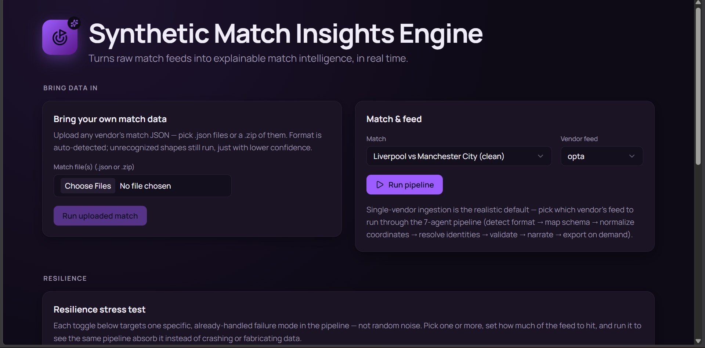
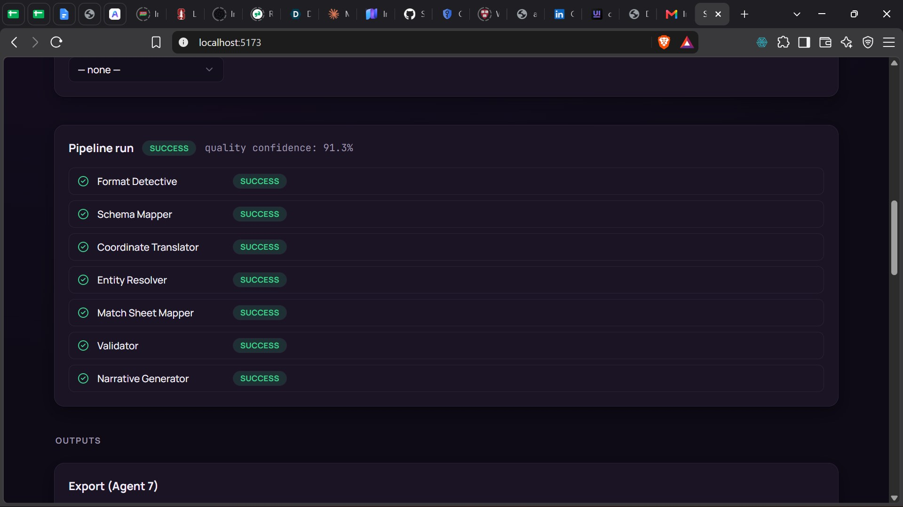

# VendorIQ

| Data Ingestion | Pipeline Run |
|:---:|:---:|
|  |  |

Built for Microsoft x Premier League's **Inside the Game: Developer Hackathon**.

A 7-agent pipeline that ingests a vendor-shaped football feed (Opta, StatsBomb, or Wyscout), normalizes it into a single Common Data Format (CDF) document, and explains it back out as computed stats plus narrative text. Each agent's progress streams to the UI live as it runs, and a live feed mode delivers a match one minute at a time so the stats update as the game unfolds.

Covers event data and match sheet data (lineups, officials, venue) honestly, never fabricating a match sheet when none is supplied. Tracking data, video, and physiological data are not wired up yet; adding them is a future phase, not a schema limitation.

Built to production standard: 315 passing tests, pinned dependencies, confidence scores computed from real data quality, and a documented fallback for every point where real-world data can arrive missing or wrong.

## Stack

| Layer | Technology |
|---|---|
| Backend | Python 3.11+, FastAPI, Pydantic v2, uvicorn |
| Frontend | React 19, Vite, Tailwind CSS v4, shadcn/ui |
| Testing | pytest (315 tests) |
| Optional narrative upgrade | Anthropic API or Groq API |

## Quick start

Requires Python 3.11+ and Node 18+.

```bash
git clone https://github.com/SeyiBuilds/VendorIQ
cd VendorIQ
pip install -r requirements.txt
pytest backend/tests -q              # expected: 315 passed

uvicorn backend.api.main:app --reload --port 8000   # terminal 1

cd frontend                                          # terminal 2
npm install
cp .env.example .env
npm run dev
```

Frontend: `http://localhost:5173`. API: `http://localhost:8000` (check `/health`).
Windows: if `pytest`/`uvicorn` are not recognized, use `python -m pytest` / `python -m uvicorn`.

## Environment variables

Nothing is required to run the full pipeline. Both are optional upgrades.

| Variable | Required | What it does |
|---|---|---|
| `ANTHROPIC_API_KEY` | No | Upgrades narrative text and AI entity-resolution escalation. Tried first if set. |
| `GROQ_API_KEY` | No | Narrative upgrade, used only if `ANTHROPIC_API_KEY` is not set. |
| `VITE_API_BASE_URL` | Yes, for frontend | Backend URL. Defaults to `http://localhost:8000` via `.env.example`. |

Without either API key, the narrative still generates in full from a deterministic template, fully offline.

## Demo data

Three synthetic matches ship in `backend/data/sample_matches/`, each with all three vendor formats and a match sheet.

| Match ID | Teams | Tier |
|---|---|---|
| `PL_2025_CLEAN_001` | Liverpool vs Man City | clean |
| `PL_2025_MESSY_001` | Man United vs Tottenham | messy |
| `PL_2025_PARTIAL_001` | Arsenal vs Chelsea | partial |

A real Wyscout open-data file also works; Format Detective auto-detects both the synthetic and real-world shape.

## Trying it

In the UI: pick a sample match, click Run pipeline, watch all seven agents complete, then check the document, match sheet, and match report (Fan and Analyst views). Use Resilience to corrupt a feed live, or Upload to run your own vendor file (format auto-detected).

**Live feed:** click Play as live feed on a sample match or an uploaded file. With several files loaded (for example a zip of matches), pick which one to play from the list. The file is delivered one match minute at a time and the full pipeline re-runs after each minute, so the score, stats, key moments and shot map update as the match unfolds. Mid-match updates use the template narrative and say "score so far"; the final update is identical to a normal run. This replays a finished file at a chosen speed; it is not connected to a real live vendor socket, but the chunking and re-run per chunk are the same mechanics a live integration would use.

Via the API:

```bash
curl -s -X POST http://localhost:8000/matches/PL_2025_CLEAN_001/run \
  -H "Content-Type: application/json" -d '{"vendor":"opta"}'
```

Expect `overall_status: "success"`, `quality_confidence: 1.0`, 300 events. The messy sample returns the same status with `quality_confidence` around `0.91`, reflecting genuine quality notes instead of a fabricated perfect score. Export a run with the `run_id` from either response:

```bash
curl -s -X POST http://localhost:8000/runs/<run_id>/export \
  -H "Content-Type: application/json" -d '{"target_vendor":"statsbomb"}'
```

## API reference

| Method | Path | Purpose |
|---|---|---|
| GET | `/health` | Liveness check |
| GET | `/matches` | List sample matches |
| POST | `/matches/{id}/run` (or `/run/stream`) | Run the pipeline |
| POST | `/ingest/run/stream` (or `/stream/multi`) | Run against uploaded file(s) |
| POST | `/matches/{id}/corrupt-and-run/stream` | Corrupt and run, streamed |
| POST | `/matches/{id}/live/stream` | Replay a sample match as a live feed |
| POST | `/ingest/live/stream` | Replay an uploaded file as a live feed |
| GET | `/runs/{run_id}` | Fetch a completed run |
| POST | `/runs/{run_id}/export` | Export to another vendor shape |

Streaming endpoints take `?pace=false` to skip the demo per-stage pause. Live endpoints take `?seconds_per_minute=` (0 to 5, default 0.6) to set replay speed.

## Architecture

`backend/agents/` holds the 7 agents (`format_detective` through `format_exporter`) plus `orchestrator.py`, which wires them together, and `live_feed.py`, which drives live replay and is the best starting point for design rationale (fallback tiers, confidence scoring, why export is on-demand). `backend/api/main.py` is the FastAPI layer; `backend/data/` holds the CDF schema, sample matches, and the corruption/fault-injection demo tools. `frontend/` is the React + Vite UI.

## Troubleshooting

| Problem | Fix |
|---|---|
| "Could not reach the API" | Confirm `uvicorn` is running on port 8000 and `frontend/.env` points at it |
| Frontend changes not showing | Restart `npm run dev` and hard-refresh |
| Narrative reads as templated | Expected without an LLM key; set `ANTHROPIC_API_KEY` or `GROQ_API_KEY` |

## Limitations

- Sample matches are synthetic, not real Premier League data.
- `RunStore` is an in-memory, single-process dict; a run does not survive a backend restart. A deliberate hackathon-scope shortcut, documented as such.
- AI narrative and entity-resolution escalation need network access; the pipeline runs fully without them.

## License

MIT. See `LICENSE`.
